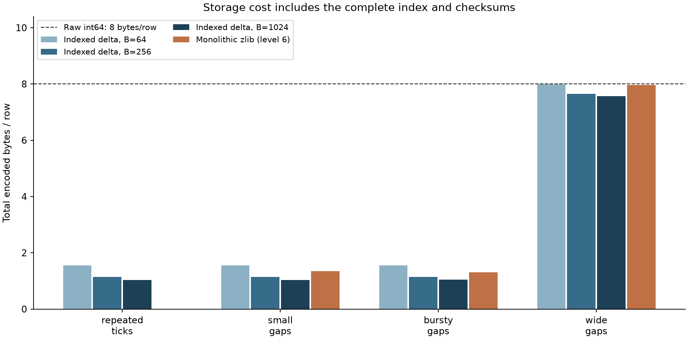
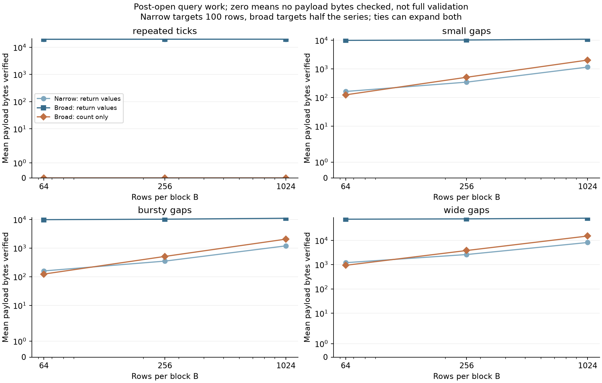

# Indexed delta timecodec

[](https://github.com/lcx0731/indexed-delta-timecodec/actions/workflows/ci.yml)

A small, dependency-free Python codec for **sorted signed-int64 timestamps**,
with block checkpoints, exact half-open range queries, and deliberately explicit
validation scope. It preserves duplicates and the full signed-int64 range.

The interesting trade-off is not simply “fewer bytes.” Smaller blocks cost more
index space but require less decoding for boundary queries. Fully covered blocks
can be counted from metadata without decoding their payloads—but that does **not**
validate the skipped payloads. This repository makes all three costs visible.

This is an original educational implementation demonstrating binary formats,
index design, integer arithmetic, corruption handling, and property-oriented
testing. It is not a production storage engine or a new compression algorithm.
All experiment inputs are deterministic synthetic integer ticks, not personal
records, market data, or real application telemetry.

## Quick start

Python 3.11 or newer:

```bash
python3 -m venv .venv
source .venv/bin/activate
python -m pip install '.[test,demo]'
python -m pytest -W error
timecodec-demo --output results
```

The core package has **no third-party dependencies**: `pip install .` is enough
to use the codec. `test` installs pytest; `demo` installs Matplotlib for plots.

```python
from timecodec import TimestampIndex, encode

blob = encode([-4, -4, 124, 16380], block_size=4)
index = TimestampIndex(blob)              # validates directory, not every payload
index.validate_all()                     # full CRC + structural payload scan
assert index.decode() == (-4, -4, 124, 16380)

selected = index.range_values(-4, 125)    # includes lower, excludes upper
assert selected.values == (-4, -4, 124)
assert selected.count == 3

counted = index.count_range(-4, 16381)
assert counted.count == 4
assert counted.blocks_decoded == 0       # fully covered: metadata is enough
assert counted.payload_bytes_verified == 0
```

The API accepts nondecreasing integer values, not floats or calendar strings.
It does not silently sort, round, deduplicate, or convert time zones. Tick units
and epoch are application-defined and **not stored in the file**. Query bounds
can extend outside int64; `upper=2**63` includes the largest int64 value.

The CLI accepts `--rows`, `--queries`, and `--seed`. Defaults are 20,000 rows per
dataset, 100 queries per workload, and seed 20261021. It overwrites four named
files in the output directory: JSON, two PNGs, and a 69-byte example `.tidx` file.
Choose a new output directory to retain an earlier run.

## What is implemented

1. Divide a series into blocks of at most `B` rows. Store each block's first and
   last timestamp, count, offset, payload length, and CRC32 in a fixed directory.
2. Store only within-block differences as canonical base-128 unsigned varints.
   Python integers avoid signed overflow: `MAX_INT64 - MIN_INT64 = 2**64 - 1`.
3. Locate candidate blocks by binary searches over their last and first values.
   For a value query, validate/decode the candidates and filter with `bisect`.
4. For a count query, obtain candidate counts from prefix sums. Only the first
   and last candidate can be partially covered, so at most **two blocks** need
   decoding. Duplicates spanning many blocks retain their full multiplicity.

The encoder, decoder, and query implementation are in
[`src/timecodec/codec.py`](src/timecodec/codec.py). The complete byte layout and
validation rules are in [`FORMAT.md`](FORMAT.md). The core uses only Python's
standard library; zlib supplies CRC32, not the timestamp payload encoding.

## Validation scope is part of the API

| Operation | What is checked | What can remain unchecked |
|---|---|---|
| `TimestampIndex(blob)` | Header/version, directory CRC, sorted checkpoints, counts, offsets, length bounds, no trailing bytes | All payload contents |
| `range_values(lo, hi)` | Above, plus CRC, canonical decoding, exact item count and final checkpoint for every candidate block | Noncandidate payloads |
| `count_range(lo, hi)` | Above, plus those payload checks on partially covered boundary blocks | Fully covered and noncandidate payloads |
| `validate_all()` / `decode()` | Every block's CRC and payload structure | No skipped payload blocks |

A query can succeed even when an irrelevant or metadata-only block has a
corrupted payload. A regression test demonstrates this explicitly. Full
validation is a separate operation; it is never silently implied by a count.

CRC32 detects many accidental errors but is **not authentication**. A party
able to modify the bytes can also recompute checksums, and checksum collisions
exist. Structural checks still reject malformed data after checksums are
recomputed, but no signed provenance or adversarial integrity is promised.
See the [Python zlib documentation](https://docs.python.org/3/library/zlib.html#zlib.crc32).

## Reproducible byte and query-work experiment

The default run uses four artificial streams, three block sizes, and two
query workloads. Every configuration is fully decoded and compared with its
input. Every query's returned values and count are compared with a direct
uncompressed `bisect` reference: **2,400 query pairs** in total.

| Synthetic stream | Construction |
|---|---|
| Repeated ticks | Every timestamp is 17 |
| Small gaps | Start at −10,000; independent draws from `[0,1,1,2,3]` |
| Bursty gaps | Start at −10,000; gaps uniformly in `{0,1,2,3}`, except a `2**20` gap every 128 rows |
| Wide gaps | Sort 20,000 seeded uniform 64-bit integers, shifted into signed int64 |

The burst positions intentionally expose block-alignment effects: with `B=64`,
every large jump falls between blocks and is represented by a new checkpoint,
not a payload delta. This is not evidence that arbitrary bursts compress equally
well. Changing units, gap distributions, block alignment, or query distributions
can change the conclusions.

### Total storage, including the index

From the committed default run, at `B=256`:

| Stream | Raw int64 bytes | Indexed delta bytes | Monolithic zlib level-6 bytes |
|---|---:|---:|---:|
| Repeated ticks | 160,000 | 22,793 | 260 |
| Small gaps | 160,000 | 22,793 | 26,877 |
| Bursty gaps | 160,000 | 22,949 | 26,158 |
| Wide gaps | 160,000 | 153,029 | 159,233 |

The indexed size includes header, directory, both checksum layers, and payloads.
zlib compresses the full little-endian raw int64 byte array, including its own
wrapper, but has **no separately constructed range index** here. This is a size
reference, not an equal-functionality latency comparison. Raw fixed-width data
itself supports direct binary search without a block directory.



There is no universal compression win. Repeated ticks strongly favor zlib in
this comparison because the custom format has no run-length encoding. A
singleton uses 64 bytes versus 8 raw; the two extreme int64 values use 74 bytes
versus 16 raw. An empty stream still has a 28-byte header/checksum envelope.

### Query work after opening the index

“Narrow” selects an interval using the endpoints of a 100-row slice. “Broad”
uses half the series. Endpoints are sampled identically across block sizes.
Ties can expand either selection: both queries match all 20,000 rows of the
repeated-tick stream. Actual match counts are recorded rather than assumed.

For small-gap data, mean bytes verified by a narrow **value** query increase
from **162.85** at `B=64` to **1,157.25** at `B=1024`, while total storage falls
from **30,983** to **20,728** bytes. At `B=256`, a broad **count** query verifies
**510** payload bytes on average, versus **10,210.20** when returning the values.
Both produce the same count; they perform different amounts of payload validation.



The vertical axis is symmetric-log so zero remains visible. Measurements are
deterministic mean payload byte counts, not measured seconds, disk reads,
memory usage, or confidence intervals. The entire blob is already in memory,
and metadata parsing/checking is excluded from these post-open query counters.
No claim of being faster than zlib, NumPy, Arrow, or a database follows from them.

`results/summary.json` records full totals, query statistics, encoded SHA-256
digests, the Python version, and zlib runtime version. For the committed
environment's dependency snapshot, use Python 3.13 and:

```bash
python -m pip install -c requirements-repro.txt '.[test,demo]'
```

The same environment and seed reproduce the JSON and sample bytes. zlib sizes,
random-library behavior, or figure rendering may differ across runtime versions.
This is a version snapshot, not a portable binary lockfile.

## Tests and complexity

**71 pytest cases** include:

- Known varint byte vectors and 1,000 seeded values checked with an independent
  positional base-128 oracle; an independently assembled complete wire fixture.
- All 252 sorted multisets of up to five values from `{-2,-1,0,1,2}`, tested at
  three block sizes across 28 intervals: **21,168 query/count pairs**.
- 400 randomized full-int64 series, including duplicates, with roundtrips and
  uncompressed range-query oracles.
- Every truncation and every single-bit mutation of a representative multiblock
  file; checksum-repaired malformed payloads; noncanonical varints, uint64 and
  int64 overflow, inconsistent counts/checkpoints, invalid offsets and versions.
- Lazy-validation scope, mutable-input isolation, empty/singleton streams,
  deterministic experiments, generated artifacts, and an end-to-end CLI call.

CI runs tests with warnings treated as errors, the full example, and dependency
checks on Python 3.11 and 3.13.

For `n` rows, block size `B`, and `K=ceil(n/B)` blocks: encoding/full validation
take O(n) time; metadata parsing takes O(K); a count query takes O(log K + B)
time with at most two payload decodes; a value query takes O(log K + qB) for
`q` candidate blocks, plus output storage. Full validation retains only one
decoded block at a time, but the encoded blob is already memory-resident.

## Limits and extensions

This reference format is immutable and in-memory, not an appendable database,
file-backed mmap index, concurrent reader/writer protocol, or authenticated
container. No calendar metadata, null values, out-of-order timestamps,
delta-of-delta, bit packing, run-length coding, or SIMD is implemented. There is
no automatic block-size tuner. A deployment would need resource budgets,
compatibility policy, independent implementation review, and real workload tests.

Unsigned base-128 varints are a standard encoding; the
[Protocol Buffers encoding guide](https://protobuf.dev/programming-guides/encoding/#varints)
provides background. The surrounding TIDX format is **not Protobuf-compatible**.
Source code, test fixtures, and figures here were written for this project.
Licensed under [MIT](LICENSE).
